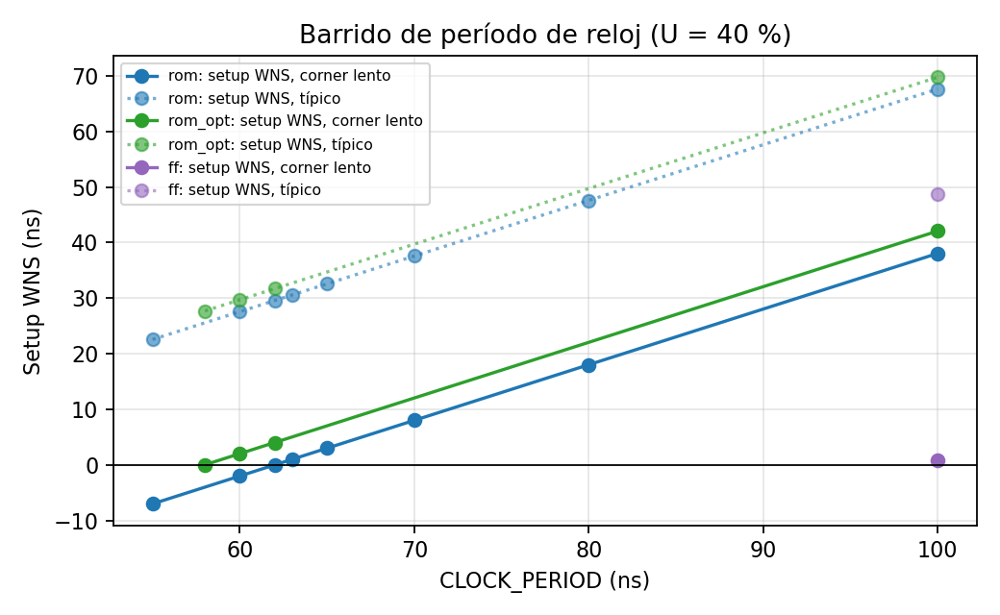
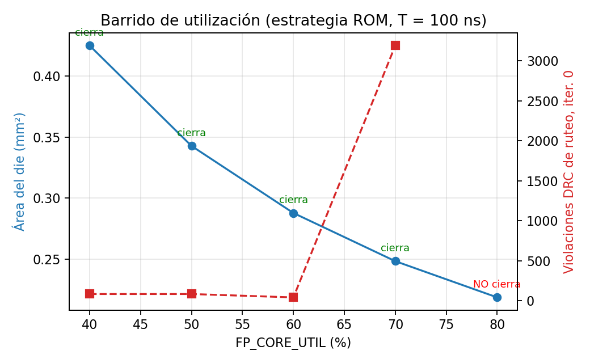
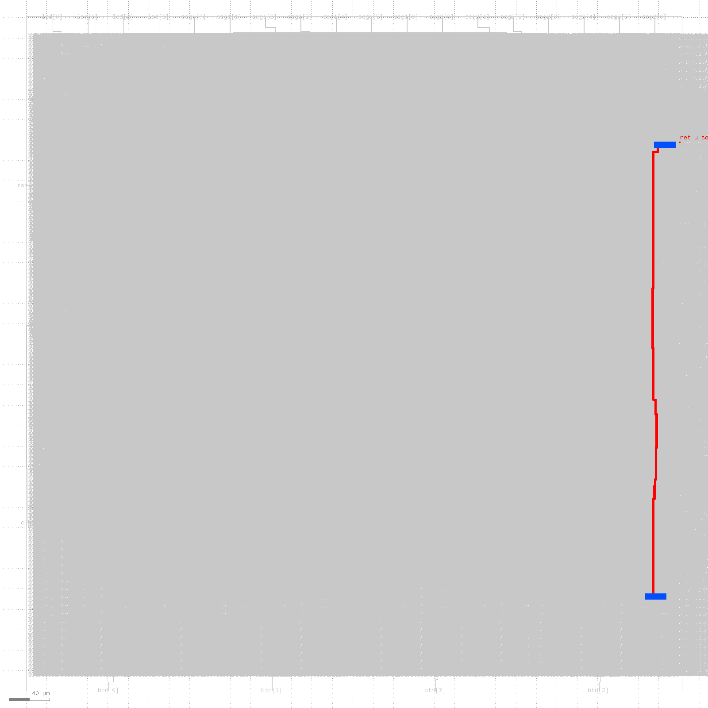

# Proyecto 3: Pochoco SoC de RTL a GDSII

**Integrantes:** Constanza Bustamante, Elena Durán y Mario Messen
**Asignatura:** Arquitectura de Computadores, 2026-2. Profesor: Jorge Gómez Mir
**Flujo:** LibreLane 3.0.17 (flake `64ef808…`), PDK gf180mcuD (open_pdks `54435919…`), biblioteca `gf180mcu_fd_sc_mcu7t5v0`
**Punto de partida:** repositorio del Proyecto 2 (RTL modificado, `game.s` y assembler propio)

## Resumen

El SoC Pochoco con el juego de reflejos del Proyecto 2 se llevó desde un diseño para FPGA (iCE40) hasta un macro digital de celdas estándar en GF180MCU. La corrida final (estrategia **ROM**, `CLOCK_PERIOD` = 100 ns, `FP_CORE_UTIL` = 40 %) termina el flujo con **DRC = 0, LVS = 0, antena = 0** y cierra setup y hold con WNS ≥ 0 y TNS = 0 en los corners típico y lento. Ocupa **0,4251 mm²**, lo que equivale a unos **US$ 9.777** con el supuesto lineal de US$ 23.000/mm². El menor período que cierra timing es **62 ns (≈ 16,1 MHz)**. El área mínima que completa el flujo es 0,2483 mm² (U = 70 %). La simulación del netlist post-síntesis reproduce ciclo a ciclo la simulación RTL.

Todos los números del informe salen de corridas guardadas en `librelane/<diseño>/runs/<tag>/` y están resumidos en `results/runs.csv`, que genera `scripts/collect.py`.

## 1. Del RTL de FPGA al RTL de ASIC (sección 3.1)

### 1.1 Módulo superior `asic_top`

`rtl/asic_top.v` solo instancia `pochoco_soc`. Sus puertos son funciones lógicas del juego:

| Puerto | Dir. | Función |
|---|---|---|
| `clk` | in | Reloj del sistema, T = 100 ns |
| `rst_n` | in | Reset asíncrono activo en bajo (se sincroniza dentro del SoC) |
| `btn[3:0]` | in | Botones, 1 = presionado (sincronizador de 2 FF en `u_periph`) |
| `led[3:0]` | out | LEDs, 1 = encendido |
| `seg1[6:0]`, `seg2[6:0]` | out | Decenas y unidades `{g,f,e,d,c,b,a}`, 1 = segmento encendido |
| `spi_sclk`, `spi_mosi`, `spi_cs_n` / `spi_miso` | in / out | Esclavo SPI |

Son terminales del macro, no pads: no tienen protección ESD ni capacidad para manejar directamente un LED o un display.

### 1.2 Construcciones dependientes de la FPGA

Para obtener la evidencia se pasó por LibreLane el RTL del Proyecto 2 sin modificar (`librelane/p2_original`), y luego dos variantes que corrigen un problema a la vez (`p2_step2`, `p2_step3`). Los logs completos están en `evidence/section_3_1/`, con la numeración de líneas original.

| # | Construcción en el RTL del P2 | Evidencia del flujo (archivo : línea) | Reemplazo |
|---|---|---|---|
| 1 | Primitiva iCE40 `SB_RAM40_4K` en `espino_register_file.v` (líneas 22 y 33) | `%Error-MODMISSING: Cannot find file containing module: 'SB_RAM40_4K'`, en `E1_p2_original_verilator-lint.log:1` y `:13`. El flujo se detiene en el lint | Register file de 15 × 32 flip-flops con reset, x0 fijo en 0 y **lectura síncrona**, para conservar la latencia de 1 ciclo y el handshake `rf_ready` de la etapa ID |
| 2 | `initial $readmemh(MemFile, mem)` en `pochoco_ram.v:36` | `ERROR: Can not open file 'sw/game.hex' for \$readmemh.`, en `E2_p2_original_yosys-jsonheader.log:406` | El assembler genera `game_program.vh`, que se sintetiza como ROM combinacional (estrategia 1) o como valores de reset de los FF (estrategia 2) |
| 3 | BRAM inferida de 512 × 32 en `pochoco_ram.v` | GF180 no tiene BRAM. Yosys la implementa con registros: `Mapping memory \u_pochoco.u_ram.mem … created 512 $dff cells … of width 32` (`E4_p2_step3_yosys-synthesis.log:1476-1477`). Resultado: **16.468 `dffq_1`** y **2.328.951 µm²** de celdas (`E4_p2_step3_stat.rpt:24`, `:50`), unas 15 veces el diseño final | Memoria dimensionada al uso real del juego (sección 2) |
| 4 | Power-on reset `reg [19:0] por_cnt = 20'b0` en `pochoco_soc.v:32` | `%Warning-PROCASSINIT: Procedural assignment to declaration with initial value: 'por_cnt'`, en `E3_p2_step2_verilator-lint.log:1`. Yosys lo convierte en un atributo `init` (`E4_…_yosys-synthesis.log:297`) | Puerto externo `rst_n` y sincronizador de 2 FF (aserción asíncrona, liberación síncrona) en `pochoco_soc.v` |
| 5 | Valores iniciales de FF (contenido de la memoria y `por_cnt`) | **Sin mensaje**: `dfflegalize` los mapea a `dffq_1`, que no tienen valor inicial, y el atributo `init` se descarta en silencio | Todo estado que debe partir conocido usa reset |
| 6 | Constantes de `game.s` calculadas para 25 MHz | **Sin mensaje** | `game.s` parametrizado con `CLK_HZ` (sección 4.4) |
| 7 | Inversión de segmentos (displays activos en bajo de la Go Board) | **Sin mensaje** | `asic_top` entrega segmentos lógicos; la polaridad corresponde al pad o a la placa |
| 8 | Reset de 2²⁰ ciclos para esperar a que las BRAM de la iCE40 estén listas | **Sin mensaje** | Ya no es necesario: no hay BRAM y el reset viene de un pin externo |

**Por qué 5 a 8 siguen siendo problemas aunque el flujo no avise.** (5) En la FPGA el bitstream inicializa los FF y las BRAM. En silicio, un FF sin reset arranca en un valor arbitrario: el chip encendería con un programa aleatorio y con un contador de reset que podría no liberar nunca a la CPU. (6) Con T = 100 ns, las constantes de 25 MHz harían que la espera durara 7,5 s en vez de 3 s, y los tiempos mostrados quedarían divididos por 2,5. (7) La polaridad depende del display y del driver del pad, no de la función lógica del macro. (8) Un contador de 20 bits con su comparador solo gastaría área para resolver una limitación de la FPGA.

## 2. Memoria y programa del juego (sección 3.2)

### 2.1 Uso real del juego

* **Instrucciones: 136 palabras.** Es la cantidad que genera el assembler (`Assembled sw/game.s: 136 words`) y la cantidad de entradas de `game_program.vh`. La pseudo-instrucción `li` siempre genera 2 palabras, así que el tamaño no depende de la frecuencia del reloj.
* **Datos: 0 palabras.** Revisión estática: todos los `lw`/`sw` de `game.s` usan como base `x1`–`x4` o `x15`, que se cargan con `lui x1, 0x80000` y offsets pequeños, es decir, siempre direcciones MMIO ≥ `0x80000000`. No hay stack ni llamadas a subrutinas (los `jal` usan `x0`). Revisión dinámica: el testbench cuenta los accesos con `ram_req` y reporta `data RAM accesses during the whole game: 0` en una partida completa con 10 aciertos y un error.

Ambos valores quedan bajo el máximo recomendado (256 instrucciones y 64 datos). Se dejaron **4 palabras de RAM de datos** como margen para modificaciones del programa.

### 2.2 Extensión del assembler

`tools/assembler.py` ahora acepta:

* `.equ NOMBRE, expresión`: constantes con nombre y aritmética entera.
* `li rd, expresión`: siempre se expande a `lui` + `addi`, con el mismo redondeo que GNU as.
* `-D NOMBRE=valor`: sobrescribe un `.equ` desde la línea de comandos (se usa para acortar los tiempos en simulación).
* `--verilog archivo.vh`: genera `GAME_WORDS` y la función combinacional `game_word(idx)`, con el desensamblado de cada palabra como comentario.

Con `-D CLK_HZ=25000000` la salida es **idéntica bit a bit** al `game.hex` del Proyecto 2. Una prueba lo verifica, junto con otras 20 (`python -m unittest tests.test_assembler`).

### 2.3 Estrategias implementadas

1. **ROM + RAM reducida (`MEM_ROM`).** `pochoco_rom.v` incluye `game_program.vh`; la síntesis convierte el `case` en compuertas y registra la salida para mantener la latencia de fetch de 1 ciclo. `pochoco_dram.v` es una RAM de 4 × 32 FF con byte enables, conectada solo al puerto de datos (Harvard).
2. **Memoria unificada de FF (`MEM_UNIFIED_FF`).** `pochoco_ram_ff.v` tiene 136 + 4 palabras de FF. El reset carga el programa: cada bit es un FF con reset a 0 o a 1 según `game_word()`. Los dos puertos (fetch y datos) conservan el contrato del `pochoco_ram` del Proyecto 2.

La estrategia se elige con un define (`VERILOG_DEFINES` en `librelane/{rom,ff}/config.json`). En simulación, ambas producen exactamente el mismo log de salida.

### 2.4 Comparación (T = 100 ns, U = 40 %)

| Métrica | ROM + RAM 4 palabras | Memoria unificada FF |
|---|---|---|
| Área de celdas tras síntesis (µm²) | 158.579 | 783.243 |
| Área de celdas tras PnR (µm²) | 202.986 | 1.066.900 |
| Flip-flops | 974 | 5.327 |
| Área del die (mm²) | 0,4251 (643 × 661 µm) | 2,0212 (1.413 × 1.431 µm) |
| Utilización final | 51,4 % | 54,7 % |
| Setup WNS tt / corner lento (ns) | 67,58 / 38,05 | 48,76 / 0,84 |
| Hold WNS tt / corner lento (ns) | 0,37 / 0,94 | 0,36 / 0,91 |
| Período mínimo que cierra / frecuencia máxima | 62 ns / 16,1 MHz (barrido) | ≈ 99,2 ns / ≈ 10,1 MHz (estimado, ver abajo) |
| DRC / LVS / redes con antena | 0 / 0 / 0 | 0 / 0 / 2 |
| Costo equivalente | US$ 9.777 | US$ 46.488 |

Corridas: `librelane/rom/runs/T100_U40` y `librelane/ff/runs/T100_U40`.

**La ROM es 4,8 veces más chica y 1,6 veces más rápida.** Con la estrategia FF, la memoria unificada (`pochoco_ram_ff`) ocupa 656.073 µm², el **84 %** del área de síntesis. Son 140 × 32 = 4.480 FF, cada uno con su lógica de escritura por byte, más **dos** multiplexores de lectura de 140:1 × 32 bits (uno para fetch y otro para datos). En la ROM, en cambio, el programa es lógica combinacional constante que ABC minimiza (12.409 µm²), y solo las 4 palabras de datos son FF. Que el programa pueda escribirse no aporta nada: el juego no modifica su código y usa 0 palabras de datos.

**Frecuencia máxima de la estrategia FF.** Una corrida FF completa tarda cerca de 1,5 h en nuestro equipo, por lo que solo se ejecutó T = 100 ns. Como se mostró en la sección 4.1, en este flujo el netlist no cambia con `CLOCK_PERIOD`, así que T_min ≈ T − WNS_lento = 100 − 0,84 ≈ 99,2 ns. Con la ROM esta estimación coincide con lo medido (100 − 38,05 = 61,95 ns, y la corrida a 62 ns cerró con 0,05 ns). La ruta crítica empieza en el registro de instrucción de `u_mem`, pasa por decoder → ALU → `lsu_addr` y termina en el registro de lectura de datos de `u_mem`, después del multiplexor de 140 entradas. Es la misma ruta de **acceso a memoria** que en la ROM, pero el mux de 140:1 le agrega unos 37 ns en el corner lento.

**Antena en la estrategia FF.** Quedan 2 redes sobre el límite después de la reparación automática (`ff/runs/T100_U40/46-openroad-checkantennas-1/reports/antenna_summary.rpt`): `u_soc/u_mem/_08678_` (Metal4, razón 503/400 = 1,26) y `u_soc/u_mem/_05179_` (Metal3, 419/400 = 1,05). Ambas son entradas de buffers de fanout de los multiplexores de lectura, porque un die de 1,4 mm de lado genera tramos de metal muy largos. El exceso es pequeño, pero existe riesgo de dañar el óxido de compuerta de esos dos buffers durante la fabricación. Se corregiría con más iteraciones de reparación (`DRT_ANTENNA_REPAIR_ITERS`) o con un diodo en esas redes. No se corrigió porque la estrategia FF no es la corrida final: la corrida final (ROM) tiene 0 violaciones de antena.

## 3. Síntesis y trazabilidad jerárquica (sección 3.3)

**Método.** Se usó `SYNTH_HIERARCHY_MODE = "keep"`: Yosys no aplana el diseño, así que `stat -liberty` reporta cada módulo por separado (`06-yosys-synthesis/reports/stat.json`), y en el netlist y el layout las celdas conservan el prefijo de su instancia (`u_soc/u_core/u_rf/…`). `scripts/synth_report.py` calcula a partir de ese archivo el área jerárquica de cada módulo (incluye sus submódulos) y cuenta sus flip-flops. El contador del Proyecto 2 se movió a su propio módulo, `pochoco_cycle_counter` (instancia `u_soc/u_periph/u_cycle_counter`), para poder medirlo.

Área total de celdas tras síntesis: **158.579 µm²**, de los que el 45,9 % son secuenciales.

### 3.1 Las cinco celdas más usadas

| Celda | Cantidad | Qué parte del diseño la explica |
|---|---|---|
| `dffrnq_1` (FF con reset) | 971 | Register file 480 bits + 64 de puertos de lectura registrados = 544; RAM de datos 160; etapa IF (PC y PC de ID) 65; contador de ciclos 64; periféricos y SPI ≈ 100; salida de la ROM 31 |
| `mux2_2` | 823 | Habilitación de escritura de cada FF (D = we ? dato : Q): 480 en el register file y 128 en la RAM; el resto en el mux de lectura de datos del SoC y en la IF |
| `aoi22_1` | 555 | Árboles de los multiplexores de lectura 16:1 del register file (2 puertos × 32 bits, 384 celdas) y selección de operandos y write-back |
| `nand2_1` | 529 | Lógica de la ROM (decodificación de 136 direcciones y bits del programa), ALU y LSU |
| `nor2_1` | 300 | ROM, comparaciones de la ALU y decodificación MMIO |

### 3.2 Área por módulo

| Módulo (instancia) | Área µm² | % | FF |
|---|---|---|---|
| `espino_core` (`u_core`) | 104.057 | 65,6 | 611 |
| — `espino_register_file` (`u_rf`) | **69.875** | **44,1** | 544 |
| — `espino_id_stage` (`u_id`), incluye decoder y ALU | 22.389 | 14,1 | 1 |
| — — `espino_alu` (`u_alu`) | 10.153 | 6,4 | 0 |
| — — `espino_decoder` | 2.215 | 1,4 | 0 |
| — `espino_if_stage` (`u_if`) | 8.511 | 5,4 | 65 |
| — `espino_load_store_unit` | 3.212 | 2,0 | 1 |
| `pochoco_dram` (`u_dram`, 4 palabras) | 18.690 | 11,8 | 160 |
| `pochoco_periph` (`u_periph`) | 14.552 | 9,2 | 116 |
| — `pochoco_cycle_counter` (`u_cycle_counter`) | **7.325** | **4,62** | 64 |
| `pochoco_rom` (`u_rom`, 136 palabras) | 12.409 | 7,8 | 31 |
| `pochoco_spi_slave` (`u_spi`) | 6.276 | 4,0 | 52 |

El módulo que más área aporta es el **register file (44,1 %)**. El **contador de ciclos del Proyecto 2 ocupa 7.325 µm², el 4,62 %** del área: son 64 FF (contador libre de 32 bits y marca de tiempo de 32 bits) más un incrementador de 32 bits.

### 3.3 Comparación con lo esperado

Antes de sintetizar esperábamos que la ALU y la ROM fueran los bloques más grandes: la ALU por sus sumadores, restadores y comparadores de 32 bits, y la ROM por guardar 136 × 32 = 4.352 bits. El resultado fue distinto:

* **El register file domina** porque está hecho de flip-flops. Un `dffrnq_1` ocupa ≈ 75 µm², contra ≈ 11 µm² de un `nand2_1`. Sus 480 bits, más un `mux2` por bit para la escritura y dos multiplexores 16:1 de 32 bits, suman 44 % del área. En la FPGA estaba en BRAM y no consumía lógica.
* **La ROM es barata (7,8 %).** Un programa fijo es una función booleana constante, y Yosys/ABC la minimizan: muchas palabras comparten campos (opcode, registros) y muchos bits son constantes por columna. No se almacenan 4.352 bits, solo la lógica que distingue las 136 palabras.
* **La RAM de datos de 4 palabras (11,8 %) es más grande que la ROM de 136**, porque cada bit escribible necesita un FF y un mux. La versión con 16 palabras sintetizaba 206.417 µm²; reducirla a 4 bajó el área un 23 %.

## 4. Timing (sección 3.4)

Restricciones: SDC por defecto de LibreLane (incertidumbre de reloj 0,25 ns, derate 5 %, `MAX_FANOUT` 10). Corners exigidos: **típico** `nom_tt_025C_5v00` y **más lento** `max_ss_125C_4v50` (proceso lento, 125 °C, 4,5 V, parásitos máximos). Los checkers de LibreLane se configuraron para fallar con violaciones en ambos (`SETUP/HOLD_VIOLATION_CORNERS = ["*tt*", "*ss*"]`).

### 4.1 Barrido de `CLOCK_PERIOD` (estrategia ROM, U = 40 %)

WNS y TNS en ns. Corner típico: `nom_tt_025C_5v00`; corner más lento: `max_ss_125C_4v50`. Datos de `results/runs.csv` (corridas `librelane/rom/runs/T<período>_U40`).

| T (ns) | Setup WNS / TNS típico | Hold WNS / TNS típico | Setup WNS / TNS lento | Hold WNS / TNS lento | Área de celdas (µm²) | ¿Cierra? |
|---|---|---|---|---|---|---|
| 100 | 67,58 / 0 | 0,37 / 0 | 38,05 / 0 | 0,94 / 0 | 202.986 | Sí |
| 80 | 47,58 / 0 | 0,37 / 0 | 18,05 / 0 | 0,94 / 0 | 202.986 | Sí |
| 70 | 37,58 / 0 | 0,37 / 0 | 8,05 / 0 | 0,94 / 0 | 202.986 | Sí |
| 65 | 32,58 / 0 | 0,37 / 0 | 3,05 / 0 | 0,94 / 0 | 202.986 | Sí |
| 63 | 30,58 / 0 | 0,37 / 0 | 1,05 / 0 | 0,94 / 0 | 202.986 | Sí |
| **62** | **29,58 / 0** | **0,37 / 0** | **0,05 / 0** | **0,94 / 0** | **202.986** | **Sí (mínimo)** |
| 60 | 27,58 / 0 | 0,37 / 0 | −1,95 / −16,67 | 0,94 / 0 | 202.986 | No |
| 55 | 22,58 / 0 | 0,37 / 0 | −6,95 / −792,57 | 0,94 / 0 | 202.986 | No |



**Menor período que cierra: T = 62 ns, es decir, f_max ≈ 1 / 62 ns ≈ 16,1 MHz.** El límite lo pone el corner lento: en el típico el setup tiene casi 30 ns de holgura a 62 ns, pero en `max_ss_125C_4v50` (transistores lentos, 125 °C, 4,5 V y parásitos máximos) la misma ruta tarda casi el doble. El hold no depende del período, porque compara dos flancos del mismo ciclo, y se mantiene positivo en todas las corridas. A 60 ns el flujo termina, pero el checker de LibreLane (`Checker.SetupViolations`) marca la corrida como fallida por las violaciones de setup en el corner lento.

**Cada valor de `CLOCK_PERIOD` puede provocar una nueva optimización del circuito** (síntesis, dimensionamiento, buffering y placement), y con ello cambiar el área. En nuestras corridas esto **no ocurrió**: entre 55 y 100 ns el área (202.986 µm²), los 974 FF, el hold y el largo de cables son idénticos, y el setup WNS cambia exactamente lo mismo que el período. Las razones salen de la configuración resuelta (`resolved.json`):

* La síntesis usa `SYNTH_STRATEGY = AREA 0`, que minimiza área y no usa el período.
* La reparación de timing (`OpenROAD.ResizerTimingPostCTS`) solo analiza el corner por defecto (`DEFAULT_CORNER = nom_tt_025C_5v00`, `RSZ_CORNERS` sin definir). Como el corner típico siempre tenía holgura, a 60 ns el log dice `[INFO RSZ-0098] No setup violations found` (`rom/runs/T60_U40/37-openroad-resizertimingpostcts/openroad-resizertimingpostcts.log:36`) y no cambia ninguna celda. Las violaciones del corner lento solo aparecen en el STA final.

Para comprobarlo, se repitió la corrida a 58 ns con `PL_RESIZER_SETUP_SLACK_MARGIN = 10` (tag `T58_U40_margin10`). El área cambió un poco (202.962 µm²), pero el slack del corner lento quedó en −0,83 ns (TNS −3,98): el margen extra tampoco basta, porque se mide en el corner típico. Por eso el período mínimo que reportamos corresponde al circuito optimizado por área, sin reparación de setup en el corner lento.

### 4.2 Ruta crítica

En todas las corridas la ruta crítica de setup es la misma:

* **Celda de inicio:** `u_soc/u_rom/_1188_` (`dffrnq_1`), un bit del registro de salida de la ROM, es decir, la instrucción recién leída (`instr_rdata`).
* **Celda de fin:** `u_soc/u_periph/_374_` (`dffrnq_1`), un bit del registro de lectura `rdata_o` de los periféricos.
* **Recorrido:** `instr_rdata` → decoder (`u_decoder`, selección de operandos) → mux de operando A (`u_id`) → sumador de la ALU (`u_alu`, cadena de acarreo hasta el bit 31) → `lsu_addr[31]` → `data_addr[31]` → decodificación MMIO en `pochoco_soc` (`is_mmio`, `per_req`) → habilitación `access` del registro de lectura en `u_periph`.
* **Módulos:** empieza en `pochoco_rom` (fetch), cruza `espino_decoder` y `espino_alu` (decode y ejecución) y termina en `pochoco_periph`.
* **Función microarquitectónica:** **acceso a memoria**. Es el cálculo de la dirección efectiva de un `lw`/`sw` (rs1 + imm en la ALU) que se usa en el mismo ciclo para decodificar el destino MMIO y habilitar el registro del periférico. En Espino, decode, ejecución y el inicio del acceso a memoria están en una sola etapa combinacional.
* Retardo en el corner lento: **61,95 ns** (arrival 63,84 ns, incluida la latencia del reloj); en el típico, 32,4 ns.

### 4.3 Cambio al RTL para acortar la ruta

**Propuesta (`OPT_PERIPH_READ`, `rtl/pochoco_periph.v`).** El registro de lectura de los periféricos se cargaba solo cuando `access & ~we` estaba activo, y `access` depende de `data_addr[31]`, el bit más lento del sumador. Pero el núcleo solo mira `data_rdata` en el ciclo siguiente a una lectura, y el mux `rd_is_per` del SoC ya elige la fuente correcta. Por eso el registro puede cargarse **en todos los ciclos** con el valor seleccionado por `addr[4:2]`, que son bits bajos y rápidos del sumador. Así se elimina de la ruta el acarreo hasta el bit 31 y la decodificación MMIO. El mismo patrón ya lo usa la RAM (`b_rdata_o` se carga siempre). La simulación RTL con el cambio produce un log **idéntico** al original.

**Resultado** (configuración `librelane/rom_opt`, igual a `rom` más el define `OPT_PERIPH_READ`, con U = 40 %):

| Métrica | `rom` (original) | `rom_opt` (con el cambio) | Diferencia |
|---|---|---|---|
| Setup WNS lento a T = 100 ns | 38,05 ns | **42,07 ns** | +4,02 ns |
| Setup WNS típico a T = 100 ns | 67,58 ns | 69,72 ns | +2,13 ns |
| Setup WNS lento a T = 62 ns | 0,05 ns | 4,07 ns | +4,02 ns |
| Setup WNS lento a T = 60 ns | −1,95 ns (no cierra) | **2,07 ns (cierra)** | |
| Hold WNS típico / lento | 0,37 / 0,94 ns | 0,40 / 0,99 ns | |
| Área de celdas tras PnR | 202.986 µm² | 201.752 µm² | −0,6 % |
| Área del die | 0,4251 mm² | 0,4231 mm² | −0,5 % |
| Flip-flops | 974 | 974 | 0 |
| Violaciones de ruteo en la iteración 0 | 84 | 3 | |
| Período mínimo que cierra | 62 ns (16,1 MHz) | **58 ns (17,2 MHz)**: a 58 ns, WNS lento = +0,07, TNS = 0 | −4 ns |

El cambio **mejoró el slack en 4 ns y redujo el área un 0,6 %**: el registro de lectura ya no necesita la lógica de habilitación `access & ~we`, y quedan menos `mux2` delante de sus FF. Con el cambio, el diseño cierra a 60 ns, donde antes fallaba.

La mejora es menor que el retardo que se quitó, porque aparece una **nueva ruta crítica** casi igual de larga. Tiene el mismo inicio (`u_soc/u_rom/_1188_`) y recorre decoder → ALU → `lsu_addr` → decodificación MMIO, pero ahora termina en `u_soc/u_periph/u_cycle_counter/_243_`, un bit del registro de marca de tiempo del contador de ciclos (llegada de 59,57 ns en el corner lento a T = 60 ns). Esa señal de captura (`capture_i = led_write & one_hot`) también depende del bit 31 de la dirección y de la decodificación del registro de LEDs, y además se reparte a 32 FF a través de buffers de fanout. La función sigue siendo **acceso a memoria**: la escritura (`sw`) al registro de LEDs. Para acortarla también habría que registrar la decodificación de la dirección, lo que agrega un ciclo de latencia a las escrituras MMIO. No lo hicimos, porque cambiaría el número de ciclos que mide el juego.

### 4.4 Constantes de `game.s` para T = 100 ns

Con T = 100 ns, f = 10 MHz, así que 1 s = 10.000.000 ciclos. En el Proyecto 2 (25 MHz) las constantes estaban escritas a mano como pares `lui`/`addi`. Ahora se derivan de `CLK_HZ`:

| Constante | Expresión | P2 (25 MHz) | P3 (10 MHz) | `lui` / `addi` generados |
|---|---|---|---|---|
| `CYC_TENTH` (0,1 s) | `CLK_HZ/10` | 2.500.000 | **1.000.000** | `0xF4` / `576` |
| `CYC_HALF_TENTH` (0,05 s, redondeo) | `CYC_TENTH/2` | 1.250.000 | **500.000** | `0x7A` / `288` |
| `CYC_PREP` (3 s de espera) | `3*CLK_HZ` | 75.000.000 | **30.000.000** | `0x1C9C` / `896` |
| `CYC_HALF_SECOND` (0,5 s, pausa final y medio divisor) | `CLK_HZ/2` | 12.500.000 | **5.000.000** | `0x4C5` / `-1216` |
| `CYC_AVG_DIV` (10 rondas × 0,1 s) | `10*CYC_TENTH` | 25.000.000 | **10.000.000** | `0x989` / `1664` |
| `CYC_SUM_LIMIT` (suma que promedia 10,0 s) | `100*CYC_AVG_DIV` | 2.500.000.000 | **1.000.000.000** | `0x3B9AD` / `-1536` |

Ejemplo del cálculo para `CYC_PREP`: 30.000.000 = 0x01C9C380. Los 12 bits bajos (0x380 = 896) son menores que 0x800, así que `addi` usa +896 y `lui` usa 0x01C9C; se verifica que 0x1C9C × 4096 + 896 = 29.999.104 + 896 = 30.000.000. Cuando los 12 bits bajos son ≥ 0x800, el `addi` es negativo y se suma 1 al `lui`: por ejemplo, 5.000.000 = 0x4C4B40 → 0x4C5 × 4096 − 1216.

El programa se regeneró (`sw/build/game.hex`, `game_program.vh`); las palabras que cambian respecto del P2 son exactamente esos 6 pares `lui`/`addi`. Con el contador de 32 bits a 10 MHz, el desborde ocurre cada 429 s, muy por encima de los 10 s máximos que se miden.

## 5. Floorplan, alimentación y placement (sección 3.5)

### 5.1 Barrido de utilización (ROM, T = 100 ns)

Corridas `librelane/rom/runs/T100_U<util>`. La utilización final es mayor que `FP_CORE_UTIL` porque el flujo agrega tap cells, buffers y celdas de hold después del floorplan.

| `FP_CORE_UTIL` | Die (µm) | Die (mm²) | Utilización final | Violaciones de ruteo iter. 0 | DRC / LVS / antena | Setup WNS lento | Largo de cables (µm) | ¿Cierra? |
|---|---|---|---|---|---|---|---|---|
| 40 % | 643 × 661 | 0,4251 | 51,4 % | 84 | 0 / 0 / 0 | 38,05 | 409.272 | Sí |
| 50 % | 577 × 595 | 0,3428 | 63,5 % | 84 | 0 / 0 / 0 | 44,51 | 374.990 | Sí |
| 60 % | 528 × 545 | 0,2878 | 75,2 % | 42 | 0 / 0 / 0 | 44,47 | 382.491 | Sí |
| **70 %** | **489 × 507** | **0,2483** | **87,4 %** | **3.189** | **0 / 0 / 0** | **46,87** | **485.839** | **Sí (área mínima)** |
| 80 % | | 0,2186 | — | — | — | — | — | No: falla el placement detallado (`DPL-0036`) |



**El área mínima con la que el diseño completa el flujo es 0,2483 mm² (`FP_CORE_UTIL` = 70 %)**, un 42 % menos que la corrida final con U = 40 %. Con 80 % ya no hay espacio en las filas para legalizar las celdas que agrega el flujo (buffers, hold, taps), y el placement detallado falla antes de rutear.

La congestión no crece de forma gradual. Hasta U = 60 % el router resuelve menos de 100 conflictos en la primera iteración, pero a 70 % salta a 3.189, y el largo total de cables sube un 27 % (de 382.491 a 485.839 µm) porque el router debe desviar redes. Aun así llega a 0 violaciones al final, así que 70 % es el límite práctico. El setup no empeoró al subir la utilización: la holgura en el corner lento pasó de 38 a 47 ns, porque con un die más chico las celdas de la ruta crítica quedan más cerca.

Las violaciones DRC de la iteración 0 del ruteo detallado (`route__drc_errors__iter:0`) se usan como métrica de congestión: indican cuántos conflictos tuvo que resolver el router. Que lleguen a 0 al final es condición para cerrar el flujo.

### 5.2 Red de alimentación

LibreLane generó el PDN por defecto para macros en GF180: sin anillo propio (`PDN_CORE_RING = false`, porque un macro se conecta a la grilla del chip que lo contiene), straps verticales de VDD/VSS en Metal4 y horizontales en Metal5, de 1,6 µm de ancho con paso de ≈ 153 µm, y rieles de celdas en Metal1. Se agregaron tap cells cada 20 µm (`FP_TAPCELL_DIST`) para fijar la polarización del pozo y del sustrato, y endcaps en los extremos de cada fila. El chequeo `Checker.PowerGridViolations` reportó 0 violaciones en VDD y en VSS. Los terminales de señal quedan en Metal2 (bordes norte y sur) y Metal3 (bordes este y oeste).

### 5.3 Ubicación de los terminales


| Borde | Terminales | Justificación |
|---|---|---|
| Oeste | `clk`, `rst_n` | Las señales globales entran juntas por un lado: el árbol de reloj parte desde ahí y quedan lejos de las salidas que conmutan |
| Sur | `btn[3:0]` | Entradas del usuario, agrupadas junto a su sincronizador |
| Norte | `led[3:0]`, `seg1[6:0]`, `seg2[6:0]` | Las 18 salidas visibles quedan juntas y se pueden rutear al mismo grupo de pads de salida |
| Este | `spi_sclk`, `spi_mosi`, `spi_cs_n`, `spi_miso` | El bus SPI completo en un solo borde, para minimizar el sesgo entre señales del bus |

**Terminales del macro vs. pads de I/O.** Los terminales son solo rectángulos de metal en el borde del macro, conectados a celdas lógicas de baja corriente. Un chip completo necesitaría una celda pad por señal (por ejemplo `gf180mcu_fd_io__in_c` y `__bi_24t`): bond pad de ~60–80 µm, protección ESD, drivers capaces de manejar mA para los LEDs y displays, cambio de nivel y pads de alimentación propios. El anillo de pads, más el área mínima de bonding, haría que el chip fuera varias veces más grande que este macro.

### 5.4 Costo estimado

Con el supuesto lineal de US$ 23.000 por mm²:

* Corrida final (ROM, U = 40 %): die de 643,08 × 661,00 µm = **0,4251 mm²**, costo ≈ 0,4251 × 23.000 = **US$ 9.777**.
* Área mínima que completa el flujo (ROM, U = 70 %): 489,41 × 507,33 µm = **0,2483 mm²**, costo ≈ 0,2483 × 23.000 = **US$ 5.711**.
* Memoria unificada de FF (U = 40 %): 1.412,77 × 1.430,69 µm = **2,0212 mm²**, costo ≈ 2,0212 × 23.000 = **US$ 46.488**.

**Limitaciones de la aproximación.** El costo real no es lineal: hay un costo fijo de máscaras y NRE (en shuttles se paga por bloques de área mínima); el rendimiento (yield) cae de forma exponencial con el área; existen pads, sellado y anillo de pads (en un chip tan chico el área de pads domina); y faltan el encapsulado, el test y el volumen de producción. El macro tampoco es un chip completo.

**Decisión con mayor impacto en área y costo: la estrategia de memoria.** La BRAM de 512 palabras del P2 sintetizada con FF ocupaba 2,33 mm² solo en celdas. La memoria unificada de FF dimensionada al juego ocupa 2,02 mm² de die (US$ 46.488), y la ROM más 4 palabras de RAM ocupa 0,425 mm² (US$ 9.777): elegir la ROM reduce el costo 4,8 veces. Después vienen dos decisiones de tamaño parecido. Subir `FP_CORE_UTIL` de 40 % a 70 % reduce el die un 42 % (de US$ 9.777 a US$ 5.711) sin cambiar la lógica: solo se quita el espacio vacío. Reducir la RAM de datos de 16 a 4 palabras baja el área de celdas un 23 %. La optimización de la ruta crítica (sección 4.3) casi no cambia el área (−0,5 %).

## 6. Signoff y layout (sección 3.6)

### 6.1 Resultados finales

| Chequeo | Herramienta | Resultado (corrida final) |
|---|---|---|
| DRC | Magic (`magic__drc_error__count`) | **0** |
| DRC de ruteo | OpenROAD TritonRoute (`route__drc_errors`) | **0** |
| LVS | Netgen (`design__lvs_error__count`) | **0** (0 dispositivos, redes y pines sin correspondencia) |
| Antena | OpenROAD `check_antennas` (`antenna__violating__nets`) | **0** redes y 0 pines |
| XOR Magic vs. KLayout | KLayout | 0 diferencias |
| Grilla de alimentación | `PowerGridViolations` | 0 |

Las violaciones de max slew y max cap que aparecen en los corners `ss` son advertencias de restricciones de diseño (DRV), no forman parte de los criterios de cierre del enunciado, y no impiden cerrar setup y hold. En la corrida final hay 2.532 pines sobre el límite de transición de 3 ns en `max_ss_125C_4v50`, 58 en el típico y 0 en los corners rápidos (`55-openroad-stapostpnr/max_ss_125C_4v50/checks.rpt`, línea 2951). Casi todos están en el register file: son las redes de selección de los multiplexores de lectura (`u_soc/u_core/u_id/_778_` → `u_rf/fanout43`, `fanout525`), que llegan a muchas compuertas `aoi22` de los 32 bits. La peor transición es de 6,3 ns. **Impacto:** una transición lenta aumenta el retardo de la celda que la recibe, pero el STA ya lo incluye en el cálculo, así que el setup y el hold reportados son válidos con esas transiciones. También aumenta el consumo por corriente de cortocircuito. Ocurren porque la reparación de DRV (`RepairDesignPostGPL`) trabaja en el corner típico, donde casi no hay violaciones. Para eliminarlas habría que repararlas también en el corner lento (`RSZ_CORNERS`) o activar `RUN_POST_GRT_DESIGN_REPAIR`, a costa de más buffers y área. `MAX_SLEW_VIOLATION_CORNERS` está vacío por defecto en LibreLane, así que el checker las informa como advertencia y no como error.

### 6.2 Violación de antena durante el desarrollo

Después del ruteo global, `OpenROAD.CheckAntennas` (paso 40) encontró **14 redes con violaciones de antena** (`evidence/section_3_6/40_checkantennas_before_summary.rpt`). La peor fue:

```
P/R   Partial  Required  Net                        Pin                    Layer
2.00  801.35   400.00    u_soc/u_spi/sclk_sync[0]   u_soc/u_spi/_272_/D    Metal2
```

Es la red entre las dos primeras etapas del sincronizador de `spi_sclk` (`_271_/Q` → `_272_/D`). El placer ubicó los dos FF a unos 450 µm de distancia en el borde este del macro (`_271_` en (607, 90) µm y `_272_` en (616, 533) µm), y el router los unió con un tramo largo vertical de Metal2. Durante la fabricación, ese metal acumula carga mientras se graba la capa, antes de que exista un camino a difusión, y la descarga a través del óxido de la compuerta de `_272_` puede dañarla. La razón entre el área lateral del metal y el área de compuerta (801) duplicaba el límite de la regla (400).



**Resolución.** El paso `OpenROAD.RepairAntennas` (paso 42, `evidence/section_3_6/42_diodeinsertion.log`) primero insertó **jumpers**: subió tramos a una capa superior, de modo que el metal conectado a la compuerta durante el grabado de las capas bajas es más corto (`Inserted 17 jumpers for 15 nets`, luego 14 jumpers en 10 redes). Para las violaciones restantes insertó **diodos de antena** (`Inserted 1 diodes`, dos veces), que dan una vía de descarga a sustrato. La verificación posterior al ruteo detallado (paso 46) reporta `Found 0 net violations` y `Found 0 pin violations`. Una mejora en el RTL o el floorplan sería ubicar el sincronizador SPI junto a sus pines del borde este; las dos etapas quedarían adyacentes y la red sería corta desde el principio.

### 6.3 Layout anotado

`scripts/annotate_layout.py` (KLayout en modo batch) toma el DEF final, filtra las celdas por el prefijo de su nombre jerárquico y las dibuja en capas de anotación sobre el GDS final. Además genera `results/layout/*.gds` para abrirlo en la GUI de KLayout.


| Bloque | Prefijo de instancia | Celdas | Ubicación (µm) |
|---|---|---|---|
| Register file | `u_soc/u_core/u_rf/` | 2.060 | (8, 86) – (345, 644): mitad izquierda |
| ALU | `u_soc/u_core/u_id/u_alu/` | 619 | (225, 165) – (398, 460): centro, junto al register file |
| Contador de ciclos | `u_soc/u_periph/u_cycle_counter/` | 192 | (447, 86) – (636, 405): borde este |

El placer ubicó la ALU pegada al register file porque sus operandos salen de los puertos de lectura del RF, y el contador cerca del borde este, junto al resto de los periféricos.

## 7. Simulación funcional post-síntesis (sección 3.7)

**Configuración.** Para que la simulación termine en segundos, el programa se ensambla con `-D CLK_HZ=2000`: 0,1 s = 200 ciclos y 3 s = 6.000 ciclos. Este es el único cambio, y se usa **el mismo programa en las dos simulaciones** (`sw/build_sim/`). `scripts/gate_sim.sh` sintetiza `asic_top` con ese programa en LibreLane y simula el RTL y el netlist (`final/nl/asic_top.nl.v`, modelos de celdas GF180 con `-DFUNCTIONAL`, sin SDF) con el mismo testbench `tb/tb_game.v`.

**Estímulos en ciclos definidos.** El testbench aplica los botones en el flanco de bajada, contando ciclos desde el ciclo en que aparece el LED objetivo: presiona el botón correcto a +250, +333, +460, +180, +610, +299, +777, +405, +150 y +520 ciclos, y lo mantiene 300 ciclos. En la tercera ronda presiona primero un botón **incorrecto** a +120 ciclos. Registra en un log cada cambio de los puertos de salida y los ciclos que mide el programa (el valor que escribe en `x15` al detectar la pulsación).

**Resultado (estrategia ROM).**

```
[cycle 6654]  round 1: target=0010 press@+250, measured=269 cycles, display=01
[cycle 13360] round 2: target=0010 press@+333, measured=353 cycles, display=02
[cycle 19869] round 3: WRONG button 0010 at +120 -> display EE, round restarted (LEDs=1111)
[cycle 26686] round 3: target=0010 press@+460, measured=482 cycles, display=02
...
[cycle 74281] round 10: target=0100 press@+520, measured=538 cycles, display=03
[cycle 75134] average display=02, LEDs=0000
data RAM accesses during the whole game: 0
RESULT: PASS (errors=0)
=== Comparing output-port and measured-cycle logs
RTL and netlist logs are IDENTICAL (47 events)
```

* **Una ronda correcta mide el mismo número de ciclos en RTL y en el netlist.** Las 10 mediciones (269, 353, 482, 196, 625, 311, 793, 426, 168 y 538 ciclos) y los 47 eventos de salida coinciden ciclo a ciclo (`diff` vacío). La medición excede al estímulo en 15–21 ciclos: es la latencia del sincronizador de botones más el bucle de sondeo del programa.
* **Una pulsación incorrecta reinicia la ronda.** En la ronda 3, el display muestra `EE`, los LEDs se apagan y, al soltar el botón, vuelven los cuatro LEDs (preparación de 3 s) sin que aumente el contador de aciertos: la partida termina igual con 10 rondas correctas.
* **Estrategia FF:** `scripts/gate_sim.sh ff` da el mismo resultado: `RESULT: PASS` en RTL y en el netlist, y `RTL and netlist logs are IDENTICAL (47 events)`. Los 10 ciclos medidos y la reacción ante `EE` son iguales a los de la estrategia ROM, porque las dos memorias tienen la misma latencia de fetch.

Los tiempos que muestra el display (`01`, `02`, …) corresponden a la escala reducida: 269 ciclos / 200 ciclos por décima ≈ 1,3 → `01`.

## 8. Reproducibilidad

El README indica cómo instalar LibreLane (Nix, revisión fijada), cómo ejecutar la corrida final (`scripts/run.sh rom final`), cómo regenerar el programa y las versiones exactas: LibreLane 3.0.17, gf180mcuD (open_pdks 54435919abffb937387ec956209f9cf5fd2dfbee) y `gf180mcu_fd_sc_mcu7t5v0`.
